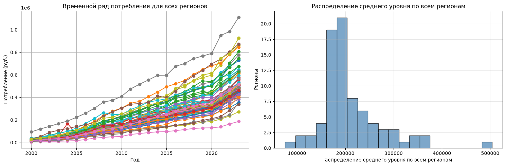
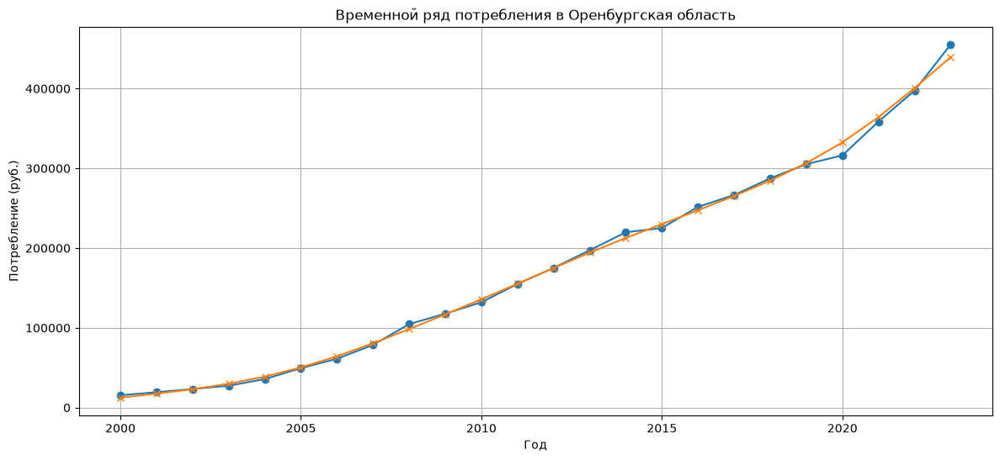
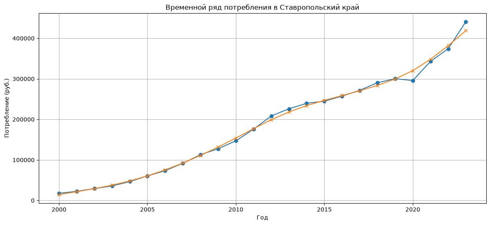
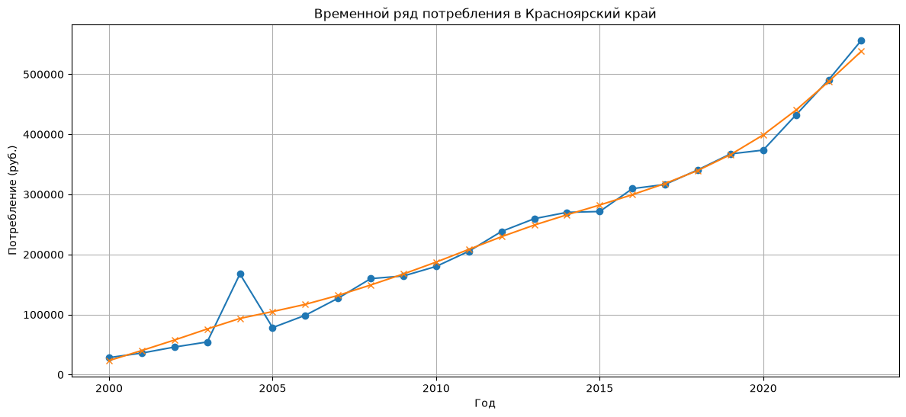
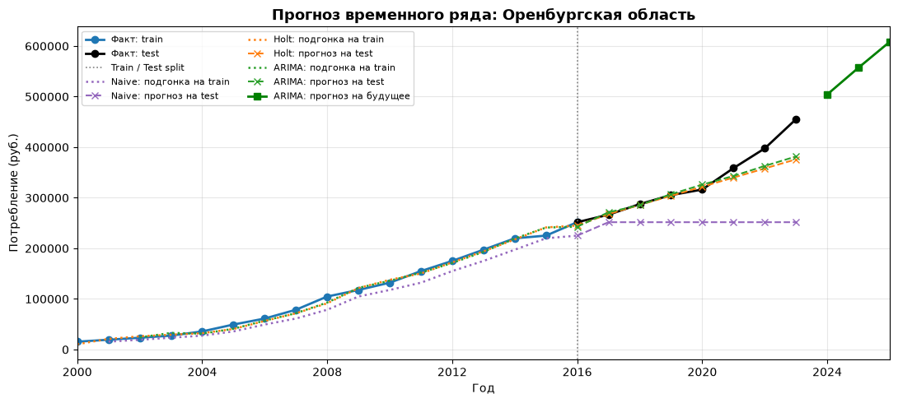
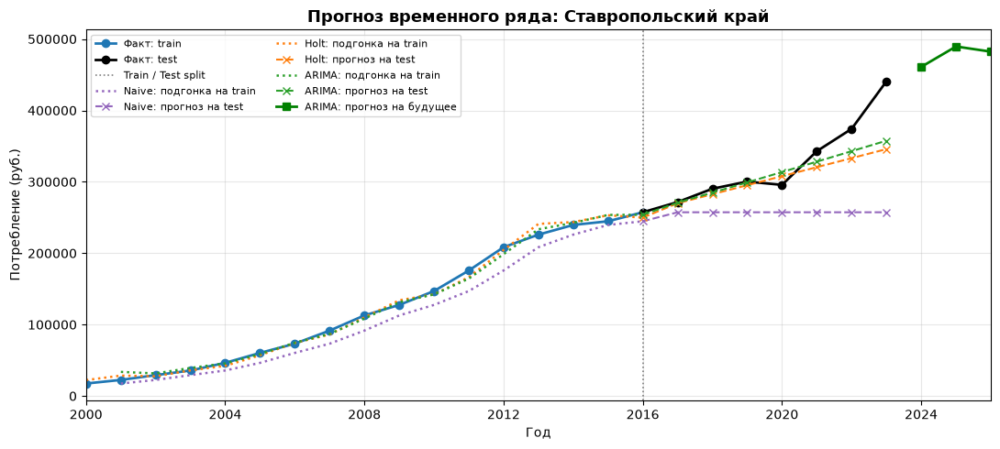
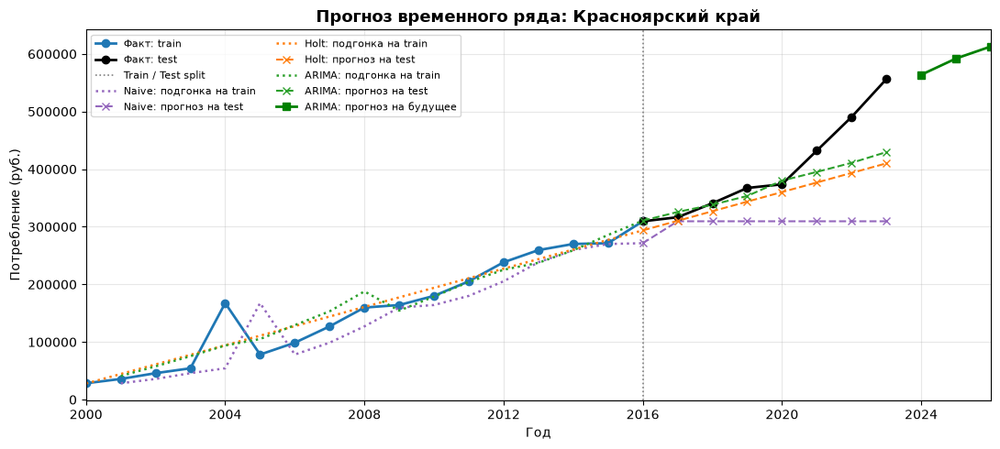

# Отчет по итоговому проекту по дисциплине «Временные ряды»

**Тема:** анализ и прогнозирование фактического конечного потребления домашних хозяйств на душу населения в регионах России.

**Автор:** Тепляков А. Н.  
**Период наблюдений:** 2000–2023 годы.  
**Основа отчета:** код и сохраненные результаты ноутбука `Teplayakov_A_N_time_row.ipynb`.

## 1. Цель и исходные данные

Цель исследования — выделить группы регионов со схожими характеристиками динамики потребления, выбрать представителей этих групп, сравнить качество трех методов прогнозирования и сформулировать рекомендации с учетом ошибок моделей.

В проекте используется файл `rsdocs_1491005410458_wide_appendix_2025.csv` с данными Росстата. Показатель измеряется в рублях на душу населения в текущих рыночных ценах. Следовательно, рост ряда отражает совместное изменение цен и объемов потребления: его нельзя непосредственно интерпретировать как рост реального благосостояния.

После удаления служебного столбца исходная таблица содержит 96 строк и 28 столбцов: четыре описательных поля и 24 годовых значения. Данные первоначально имеют строковый тип, а некоторые территории представлены неполными рядами.

Отчет подготовлен по сохраненным результатам вычислений. Исходный CSV в текущей папке `data` отсутствует, поэтому полная повторная загрузка и проверка первичных данных не выполнялась. Для численного прогноза на 2024–2026 годы отдельно восстановлены три ряда из сохраненных таблиц ноутбука и применена та же функция `auto_arima`. Эти годы являются прогнозным горизонтом относительно конца выборки 2023 года, а не фактически наблюденными результатами.

## 2. Подготовка данных

Из анализа исключены общероссийская строка и восемь федеральных округов. Для устранения территориального дублирования удалены строки «Архангельская область без автономного округа» и «Тюменская область без автономных округов»; сохранены строки областей целиком. Две территории с короткой историей наблюдений удалены на предварительном этапе. Еще четыре ряда исключены после проверки полноты: Ненецкий автономный округ, Ханты-Мансийский автономный округ — Югра, Чеченская Республика и Ямало-Ненецкий автономный округ. Недостающие начальные значения не восстанавливались.

Таким образом, из 96 исходных строк исключены 17; итоговая выборка включает 79 полных рядов по 24 наблюдения, или 1896 пар «регион — год». После исключения отдельных автономных округов сохранение соответствующих областей целиком не приводит к их повторному учету в итоговой выборке. При этом состав выборки следует учитывать при интерпретации региональных сравнений.

Широкий формат преобразован функцией `pd.melt` в длинный с полями «регион», «год», «значение». Десятичные запятые заменены точками, специальные обозначения пропусков приведены к `NaN`, значения преобразованы в числовой тип. Регион исключался целиком, если хотя бы одно из 24 значений отсутствовало. Для последующего анализа построена матрица «год × регион».

## 3. Кластеризация регионов

Для каждого региона рассчитаны средний уровень потребления, коэффициент вариации, среднегодовой прирост CAGR, отношение последнего значения к первому, минимальный годовой темп прироста и доля лет со снижением показателя. CAGR вычислялся за 23 годовых интервала.

В фактическом коде кластеризации применяется K-means по пяти стандартизированным признакам. Отношение последнего значения к первому исключено из этой модели, поскольку на одинаковом временном интервале оно однозначно связано с CAGR. Стандартизация `StandardScaler` позволяет сопоставлять признаки в рублях, процентах и долях. Использованы 50 инициализаций и `random_state=42`. Упоминания агломеративной кластеризации и PCA в описательных ячейках не соответствуют выполненному алгоритму.

K-means позволяет выделить группы, близкие по совокупности характеристик, и затем выбрать регионы около их центров. Вместе с тем метод чувствителен к выбросам и масштабу признаков, что существенно для интерпретации отдельного кластера Красноярского края.

### 3.1. Выбор числа кластеров

| k | Silhouette | Размеры групп | Минимальный размер группы |
| --- | --- | --- | --- |
| 2 | 0.4099 | {0: 59, 1: 20} | 20 |
| 3 | 0.3993 | {0: 59, 1: 19, 2: 1} | 1 |
| 4 | 0.3493 | {0: 46, 1: 17, 2: 1, 3: 15} | 1 |

Наибольший коэффициент силуэта получен при двух кластерах — 0,4099. В проекте для содержательного анализа сохранены три кластера: силуэт уменьшается до 0,3993, но Красноярский край выделяется отдельно из-за экстремального минимального годового изменения. Поэтому три кластера — осознанный аналитический выбор, а не оптимум по метрике. Четыре кластера дают меньший силуэт 0,3493 и сохраняют группу из одного региона.

### 3.2. Характеристики групп

| Кластер | Число регионов | Среднее значение | Коэфф. вариации | Среднегодовой темп роста | Макс. падение | Доля отрицат. динамики |
| --- | --- | --- | --- | --- | --- | --- |
| 0 | 59 | 200429.906 | 73.025 | 15.753 | 2.656 | 0.001 |
| 1 | 19 | 238637.892 | 66.537 | 14.994 | -2.290 | 0.041 |
| 2 | 1 | 232202.529 | 63.187 | 13.807 | -53.292 | 0.043 |

В таблице средний уровень измеряется в рублях, коэффициент вариации, CAGR и минимальное изменение — в процентах, доля отрицательной динамики — в долях единицы. Название «Макс. падение» в исходных таблицах фактически означает минимум годовых темпов прироста: положительное значение означает отсутствие падения.

**Кластер 0 — преимущественно растущие ряды.** В него вошли 59 регионов. Средний уровень составляет 200,4 тыс. руб., средний CAGR — 15,75%. Снижения номинального потребления редки. Представитель — Оренбургская область.

**Кластер 1 — ряды с более выраженными эпизодами снижения.** Группа включает 19 регионов, средний уровень — 238,6 тыс. руб., CAGR — 14,99%. Средняя доля лет со снижением равна примерно 4,1%. Коэффициент вариации уровней здесь ниже, чем в кластере 0, поэтому группу нельзя автоматически считать более волатильной по всем критериям. Представитель — Ставропольский край.

**Кластер 2 — отдельный аномальный ряд.** Включает только Красноярский край. В сохраненной таблице значение за 2004 год составляет 167 593,2 руб., а за 2005 год — 78 279,6 руб., что дает снижение на 53,29%. Именно эта особенность существенно влияет на выделение региона. Без сверки с первоисточником нельзя утверждать, что скачок отражает экономический процесс: возможны ошибка данных или изменение методики. В отчете значение сохранено как в ноутбуке.

Коэффициент вариации рассчитан по уровням трендовых рядов за весь период. Он отражает также долгосрочный рост и не является чистой мерой случайных колебаний или экономического риска.

Рисунок 1. Динамика потребления по всем регионам и распределение средних уровней. Общая восходящая динамика сочетается с различиями номинальных уровней.

## 4. Выбор регионов и описательная статистика

В каждом кластере выбран регион с минимальным квадратом евклидова расстояния до среднего профиля своей группы. На этапе выбора представителей стандартизированы все шесть рассчитанных признаков, включая отношение конечного уровня к начальному; это небольшое отличие от пяти признаков самой кластеризации. Для одноэлементной группы выбор Красноярского края определяется автоматически.

| region_name | Среднее значение | Максимальное значение | Минималное значение | коэффициент наклона |
| --- | --- | --- | --- | --- |
| Оренбургская область | 178194.083 | 455308.900 | 15462.500 | 18203.306 |
| Ставропольский край | 184669.137 | 440721.900 | 17488.300 | 17270.516 |
| Красноярский край | 232202.529 | 556338.000 | 28411.200 | 20211.434 |

Среднее, минимум и максимум указаны в рублях на душу населения; наклон — в рублях в год. Наклон получен линейной регрессией первой степени. Самый большой абсолютный тренд у Красноярского края — около 20,2 тыс. руб. в год, далее следуют Оренбургская область — 18,2 тыс. и Ставропольский край — 17,3 тыс. руб. в год.

Среднегодовой номинальный прирост за 2000–2023 годы равен соответственно 13,81%, 15,84% и 15,06%. Более высокий абсолютный наклон Красноярского края сочетается с более низким относительным приростом из-за различий исходных уровней и траекторий.

## 5. Анализ тренда и стационарности

Для выделения плавного тренда использован фильтр Ходрика — Прескотта с параметром λ = 6,25. Дополнительно в коде рассчитано трехлетнее скользящее среднее. Годовая частота не позволяет исследовать внутригодовую сезонность, поэтому сезонная декомпозиция и сезонные компоненты моделей не применялись.

Рисунок 2. Оренбургская область: исходный ряд и тренд Ходрика — Прескотта.

Рисунок 3. Ставропольский край: исходный ряд и тренд Ходрика — Прескотта.

Рисунок 4. Красноярский край: исходный ряд и тренд Ходрика — Прескотта.

Во всех трех рядах присутствует рост номинального уровня. Для Ставропольского края заметен эпизод снижения в 2020 году: с 300 318,9 до 295 748,7 руб., или на 1,52%. В Оренбургской области и Красноярском крае в 2020 году уровень вырос, но заметно медленнее, чем в последующие годы. Аномалия Красноярского края в начале периода нарушает плавность общей траектории.

### 5.1. Тест Дики — Фуллера

| Регион | Преобразование | ADF | p-value | Вывод при α=0,05 |
| --- | --- | --- | --- | --- |
| Оренбургская область | Исходный ряд | 2.142515 | 0.998832 | Гипотеза единичного корня не отвергается |
| Оренбургская область | Первые разности | -1.090243 | 0.718947 | Гипотеза единичного корня не отвергается |
| Оренбургская область | Разности логарифмов | -3.335360 | 0.013370 | Гипотеза единичного корня отвергается |
| Ставропольский край | Исходный ряд | -0.765862 | 0.828945 | Гипотеза единичного корня не отвергается |
| Ставропольский край | Первые разности | -2.544998 | 0.104906 | Гипотеза единичного корня не отвергается |
| Ставропольский край | Разности логарифмов | -0.984715 | 0.758798 | Гипотеза единичного корня не отвергается |
| Красноярский край | Исходный ряд | 0.869622 | 0.992681 | Гипотеза единичного корня не отвергается |
| Красноярский край | Первые разности | 1.725302 | 0.998189 | Гипотеза единичного корня не отвергается |
| Красноярский край | Разности логарифмов | -7.366685 | 0.000000 | Гипотеза единичного корня отвергается |

При уровне значимости 5% гипотеза единичного корня для исходных рядов не отвергается: p-value составляет 0,9988, 0,8289 и 0,9927. Это не доказывает нестационарность, но не дает основания считать уровни стационарными в рамках выполненного теста.

Первые разности уровней также не проходят проверку на данном уровне значимости. После перехода к разностям логарифмов гипотеза единичного корня отвергается для Оренбургской области и Красноярского края, но сохраняется для Ставропольского края. Вывод «одного дифференцирования достаточно для всех регионов» результатами не подтверждается. Значение p-value 0,000000 для Красноярского края является округлением малого числа.

### 5.2. Автокорреляции и выбор ARIMA

В ноутбуке построены ACF/PACF уровней и первых разностей. Коррелограммы уровней следует интерпретировать с учетом общего тренда. Гипотеза о малых порядках AR и MA служит отправной точкой, но сама по себе не устанавливает окончательную спецификацию. При 24 наблюдениях выводы по большим лагам особенно неустойчивы.

Для подбора ARIMA используется `auto_arima`: p и q рассматриваются от 0 до 5, d определяется автоматически, сезонность отключена, поиск выполняется пошагово. Для тестового прогноза порядок подбирается только по обучающей части. Конкретные порядки моделей, использованных в сохраненной оценке на test, отдельно не выведены; их нельзя достоверно восстановить из одной таблицы ошибок.

## 6. Сравнение моделей прогнозирования

Каждый ряд разделен на 17 обучающих наблюдений за 2000–2016 годы и семь тестовых за 2017–2023 годы. Доля обучения составляет 70,83%. Фиксированный прогноз строится сразу на все семь лет без обновления по фактическим значениям test.

Сравнивались три модели:

1. **NaiveForecaster, strategy="last":** повторяет последний уровень обучающей выборки.
2. **Holt:** экспоненциальное сглаживание с аддитивным трендом без сезонности.
3. **ARIMA:** авторегрессионная интегрированная модель скользящего среднего с автоматическим подбором порядка.

RMSE = √mean((y − ŷ)²) измеряет величину ошибки в рублях и сильнее реагирует на крупные отклонения. MAPE = mean(|y − ŷ| / |y|) × 100% позволяет сопоставлять относительную точность. Все наблюдаемые значения положительны.

| Регион | Модель | RMSE | MAPE,% |
| --- | --- | --- | --- |
| Оренбургская область | Naive | 108711.240 | 23.888 |
| Оренбургская область | Holt | 34347.614 | 5.132 |
| Оренбургская область | ARIMA | 31605.143 | 5.051 |
| Ставропольский край | Naive | 91958.940 | 20.237 |
| Ставропольский край | Holt | 40403.376 | 6.866 |
| Ставропольский край | ARIMA | 34759.929 | 5.726 |
| Красноярский край | Naive | 129407.647 | 21.992 |
| Красноярский край | Holt | 70569.433 | 10.707 |
| Красноярский край | ARIMA | 58650.895 | 8.096 |

ARIMA показала наименьшие RMSE и MAPE во всех трех регионах. В Оренбургской области MAPE составляет 5,05%, в Ставропольском крае — 5,73%, в Красноярском крае — 8,10%. Относительно Holt преимущество по RMSE составляет примерно 8,0%, 14,0% и 16,9% соответственно. Близость MAPE ARIMA и Holt в Оренбургской области требует осторожности при выводах о превосходстве модели.

Naive существенно уступает моделям с учетом динамики, поскольку фиксированный уровень 2016 года не описывает последующий рост. Преимущество ARIMA в этой выборке согласуется с возможностью моделировать зависимость изменений от прошлых значений. Оно не означает, что ARIMA всегда точнее Holt или что ее превосходство статистически доказано: специальный тест различий ошибок не проводился.

### 6.1. Проверка устойчивости

Для лучшей модели каждого региона применено расширяющееся окно. На каждой итерации добавлялось фактическое наблюдение, модель заново оценивалась и строила прогноз на следующий год. Начальное окно — 17 лет, проверены все семь лет test.

| Регион | Модель | RMSE_fixed | RMSE_expanding | Проверено лет | MAPE_fixed,% | MAPE_expanding(avg),% | Δ, п.п. |
| --- | --- | --- | --- | --- | --- | --- | --- |
| Оренбургская область | ARIMA | 31605.143 | 17322.669 | 7 | 5.051 | 3.570 | -1.480 |
| Ставропольский край | ARIMA | 34759.929 | 28024.381 | 7 | 5.726 | 5.650 | -0.080 |
| Красноярский край | ARIMA | 58650.895 | 48866.236 | 7 | 8.096 | 7.250 | -0.850 |

Ежегодное обновление снижает RMSE во всех трех регионах. Наибольшее улучшение наблюдается в Оренбургской области: с 31,6 до 17,3 тыс. руб.; средняя абсолютная процентная ошибка уменьшается с 5,05% до 3,57%. В Ставропольском крае изменение MAPE невелико — с 5,73% до 5,65%. В Красноярском крае она уменьшается с 8,10% до 7,25%, но однолетняя ошибка достигает 17,63% в 2023 году.

Эти оценки относятся к разным режимам: семилетнему прогнозу без обновления и последовательным однолетним прогнозам. Улучшение нельзя приписывать только устойчивости метода. Кроме того, лучшая модель выбрана по тому же test, поэтому проверка носит описательный характер и не заменяет независимую валидацию.

### 6.2. Прогноз на 2024–2026 годы

Для численного представления прогноза модели повторно обучены на всех 24 значениях, восстановленных из таблиц ноутбука. Настройки подбора совпадают с кодом проекта. Порядки, полученные на полном ряду: Оренбургская область — ARIMA(1,2,0), Ставропольский край — ARIMA(3,1,0), Красноярский край — ARIMA(1,1,0). Они относятся к дополнительному расчету на полном ряду, а не к сохраненной оценке test.

| Регион | Факт 2023, руб. | Прогноз 2024, руб. | Прогноз 2025, руб. | Прогноз 2026, руб. | Изменение 2026 к 2023 |
| --- | --- | --- | --- | --- | --- |
| Оренбургская область | 455308.90 | 504250.43 | 557265.48 | 608381.11 | 33.62% |
| Ставропольский край | 440721.90 | 460929.29 | 489550.75 | 482302.61 | 9.43% |
| Красноярский край | 556338.00 | 563816.25 | 592076.88 | 612921.37 | 10.17% |

Оренбургская область имеет наиболее выраженный прогнозный прирост: до 608,4 тыс. руб. в 2026 году, или на 33,62% к 2023 году. Для Ставропольского края прогнозируется рост до 489,6 тыс. руб. в 2025 году и снижение до 482,3 тыс. руб. в 2026 году; последнее соответствует −1,48% за год. Для Красноярского края прогноз на 2026 год составляет 612,9 тыс. руб., или +10,17% к 2023 году.

Это условные точечные прогнозы по истории до 2023 года. Они не включают информацию последующих лет. Интервалы неопределенности в проекте не представлены. Особенно осторожно следует трактовать замедление в Красноярском крае: модель ранее недооценивала ускорение роста в конце тестового периода.

Рисунок 5. Оренбургская область: история, подгонка моделей, прогнозы на test и трехлетний прогноз из сохраненного ноутбука.

Рисунок 6. Ставропольский край: история, подгонка моделей, прогнозы на test и трехлетний прогноз из сохраненного ноутбука.

Рисунок 7. Красноярский край: история, подгонка моделей, прогнозы на test и трехлетний прогноз из сохраненного ноутбука.

На графиках ошибка в конце test проявляется как отставание прогнозных траекторий от фактических уровней. Подгонка на train служит иллюстрацией и не является независимой оценкой точности. Числа в таблице прогноза выше получены отдельным повторным расчетом; линии на рисунках сохранены из исходного ноутбука.

## 7. Анализ ошибок

В таблице представлены пять крупнейших ошибок фиксированного прогноза ARIMA по каждому региону. Знак ошибки определен как «факт минус прогноз»: положительное значение означает недооценку потребления.

| Регион | Модель | Год | Факт | Прогноз | Ошибка | Абсолютная ошибка | Ошибка,% | Место |
| --- | --- | --- | --- | --- | --- | --- | --- | --- |
| Оренбургская область | ARIMA | 2023 | 455308.90 | 381661.69 | 73647.21 | 73647.21 | 16.18 | 1 |
| Оренбургская область | ARIMA | 2022 | 397631.20 | 362930.20 | 34701.00 | 34701.00 | 8.73 | 2 |
| Оренбургская область | ARIMA | 2021 | 358689.30 | 343204.54 | 15484.76 | 15484.76 | 4.32 | 3 |
| Оренбургская область | ARIMA | 2020 | 316281.60 | 325992.00 | -9710.40 | 9710.40 | 3.07 | 4 |
| Оренбургская область | ARIMA | 2017 | 266559.60 | 271350.03 | -4790.43 | 4790.43 | 1.80 | 5 |
| Ставропольский край | ARIMA | 2023 | 440721.90 | 357584.57 | 83137.33 | 83137.33 | 18.86 | 1 |
| Ставропольский край | ARIMA | 2022 | 374178.30 | 342908.29 | 31270.01 | 31270.01 | 8.36 | 2 |
| Ставропольский край | ARIMA | 2020 | 295748.70 | 313682.22 | -17933.52 | 17933.52 | 6.06 | 3 |
| Ставропольский край | ARIMA | 2021 | 342937.60 | 328266.04 | 14671.56 | 14671.56 | 4.28 | 4 |
| Ставропольский край | ARIMA | 2018 | 290313.20 | 284887.58 | 5425.62 | 5425.62 | 1.87 | 5 |
| Красноярский край | ARIMA | 2023 | 556338.00 | 429641.31 | 126696.69 | 126696.69 | 22.77 | 1 |
| Красноярский край | ARIMA | 2022 | 490620.90 | 411013.66 | 79607.24 | 79607.24 | 16.23 | 2 |
| Красноярский край | ARIMA | 2021 | 432207.10 | 395254.89 | 36952.21 | 36952.21 | 8.55 | 3 |
| Красноярский край | ARIMA | 2019 | 367377.70 | 353451.67 | 13926.03 | 13926.03 | 3.79 | 4 |
| Красноярский край | ARIMA | 2017 | 316572.50 | 325731.60 | -9159.10 | 9159.10 | 2.89 | 5 |

Для всех трех регионов максимальная ошибка приходится на 2023 год. В Оренбургской области недооценка составляет 73,6 тыс. руб. на человека, в Ставропольском крае — 83,1 тыс., в Красноярском крае — 126,7 тыс. руб. Общая особенность — недооценка ускорения номинального роста в 2021–2023 годах. При этом год 2023 является и самым дальним, седьмым шагом фиксированного прогноза, поэтому рост ошибки связан также с увеличением горизонта.

В 2020 году прогноз завысил фактический уровень во всех регионах. Абсолютные ошибки составили 9,7 тыс. руб. для Оренбургской области, 17,9 тыс. для Ставропольского края и 6,4 тыс. для Красноярского края. Для последнего 2020 год занимает лишь шестое место из семи и не входит в топ-5. Следовательно, нельзя считать пандемийный год универсально самым сложным для прогноза.

В ноутбуке дополнительно рассчитаны однолетние исторические прогнозы для 2008, 2009 и 2020 годов. Для Красноярского края процентные ошибки в 2008 и 2009 годах составили 50,21% и 46,12%, тогда как для Оренбургской области — 10,27% и 9,27%, для Ставропольского края — 2,79% и 4,02%. Эти результаты нельзя сравнивать с семилетним test как одну выборку: использовались другие обучающие окна, причем ранние окна содержали всего 8–9 наблюдений.

Сопоставление с кризисом 2008–2009 годов, пандемией 2020 года и изменениями внешних условий в 2022 году используется в проекте как основа для гипотез. Возможные объяснения ошибок — изменение темпа номинального роста, ценовая динамика, структурные сдвиги и влияние аномального наблюдения. Причинная связь с конкретными событиями моделью не установлена, поскольку соответствующие внешние переменные в нее не включены. Аналогичная отдельная проверка 2014 года в ноутбуке не выполнена.

## 8. Индивидуальные рекомендации

Рекомендации относятся к условному планированию на прогнозном горизонте 2024–2026 годов по информации до конца 2023 года. Они не являются актуальным прогнозом с учетом последующих наблюдений.

### Оренбургская область

1. Для расчетов номинального потребительского спроса использовать ориентиры 504,3 тыс. руб. на человека в 2024 году, 557,3 тыс. в 2025 году и 608,4 тыс. в 2026 году. Прогнозный прирост 33,62% к 2023 году позволяет сформировать сценарий расширения спроса, но решения о физическом объеме инфраструктуры требуют отдельно исключить влияние инфляции и учесть население.
2. Пересчитывать прогноз ежегодно после выхода новых данных: в проверке на истории это снизило RMSE с 31,6 до 17,3 тыс. руб. и MAPE с 5,05% до 3,57%. Более низкая ошибка при обновлении делает такой режим предпочтительным для оперативных расчетов.
3. Сохранять Holt как альтернативный сценарий: MAPE 5,13% близка к 5,05% у ARIMA. Усреднение прогнозов можно проверить на отдельной валидации, однако качество ансамбля в текущем проекте не оценивалось.

### Ставропольский край

1. При планировании учитывать немонотонную траекторию: 460,9 тыс. руб. в 2024 году, 489,6 тыс. в 2025 году и 482,3 тыс. в 2026 году. Снижение на 1,48% в последнем году использовать как сценарий проверки устойчивости планов; по одной модели нельзя утверждать неизбежность спада.
2. Проверять чувствительность решений к отклонениям выше средней MAPE 5,65%: в однолетнем режиме ошибки достигали 14,20% в 2021 году и 11,42% в 2023 году. Для проектов, чувствительных к спросу, отдельно оценивать последствия повторения ошибок такого масштаба.
3. Учитывать смену динамики после 2020 года: снижение на 1,52% сменилось ростом примерно на 15,96% в 2021 году. При новом резком изменении пересматривать модель и ее параметры; простое ежегодное обновление в текущем расчете почти не изменило среднюю MAPE.

### Красноярский край

1. До использования отдельного кластера в содержательных решениях проверить первичное значение за 2004 год — 167 593,2 руб. — и последующее падение на 53,29%. После сверки повторить кластеризацию и прогнозирование; автоматическое исправление наблюдения без первоисточника не обосновано.
2. Использовать прогноз 563,8; 592,1 и 612,9 тыс. руб. на 2024–2026 годы вместе со сценарием более быстрого роста. В 2023 году фиксированный прогноз недооценил уровень на 22,77%, а однолетний — на 17,63%, поэтому одного базового значения недостаточно для решений, чувствительных к дефициту мощностей.
3. Для улучшения модели отдельно проверить логарифмическое преобразование и способы учета выброса. ADF для разностей логарифмов отвергает единичный корень, тогда как первые разности уровней не проходят проверку. Эффект нового подхода необходимо оценивать на последовательных прогнозах, а не по подгонке всей истории.

## 9. Итоговые выводы и ограничения

Исследование разделило 79 регионов на три аналитические группы: преимущественно растущие ряды, ряды с более частыми эпизодами снижения и отдельный аномальный ряд Красноярского края. При этом максимум силуэта соответствует двум группам; трехкластерное решение помогает исследовать аномалию отдельно, но требует проверки устойчивости.

ARIMA оказалась лучшей из трех рассмотренных моделей во всех выбранных регионах на test 2017–2023 годов. Наименьшая относительная ошибка получена для Оренбургской области — 5,05%, наибольшая для Красноярского края — 8,10%. Это вывод о трех выбранных рядах, а не обо всех регионах соответствующих кластеров.

На точность влияют короткая история из 24 наблюдений, изменение темпов роста, аномалии данных и длина горизонта. Обновление моделей уменьшает средние ошибки, однако не устраняет крупные промахи в отдельные годы. Кластеризация и выбор представителей выполнены по полному периоду, включая test; это допустимо для описания групп, но ограничивает трактовку всей процедуры как полностью независимого эксперимента прогнозирования.

Дополнительные ограничения — номинальные цены, отсутствие внешних регрессоров и интервалов прогноза, выбор лучшей модели по тому же test и отсутствие отдельной проверки значимости различий ее ошибок с Holt. Автоматический подбор порядка на столь коротких рядах может быть нестабилен. Отсутствие исходного CSV в текущей папке также ограничивает воспроизводимость подготовки данных.

Для продолжения работы целесообразно восстановить доступ к исходному файлу и проверить аномалию Красноярского края; перейти к реальным значениям с подходящим дефлятором; проверить логарифмирование; добавить экономически обоснованные внешние признаки; провести вложенную временную валидацию, а также оценить интервалы и ансамбли. Если требуется оценивать всю процедуру как прогнозную, признаки кластеризации и выбор представителей нужно рассчитывать только по данным, доступным до начала test.

## Приложение. Состав кластеров

#### Кластер 0: 59 регионов

Амурская область, Архангельская область, Астраханская область, Белгородская область, Брянская область, Владимирская область, Волгоградская область, Вологодская область, Еврейская автономная область, Ивановская область, Иркутская область, Кабардино-Балкарская Республика, Калинингpадская область, Калужская область, Камчатский край, Карачаево-Черкесская Республика, Кировская область, Костромская область, Краснодарский край, Курская область, Ленинградская область, Липецкая область, Магаданская область, Московская область, Мурманская область, Нижегородская область, Новгородская область, Новосибирская область, Оренбургская область, Орловская область, Пензенская область, Приморский край, Псковская область, Республика Адыгея, Республика Алтай, Республика Башкортостан, Республика Бурятия, Республика Ингушетия, Республика Калмыкия, Республика Карелия, Республика Марий Эл, Республика Мордовия, Республика Северная Осетия – Алания, Республика Татарстан, Республика Тыва, Республика Хакасия, Рязанская область, Саратовская область, Сахалинская область, Смоленская область, Тверская область, Томская область, Тульская область, Удмуртская Республика, Ульяновская область, Хабаровский край, Чувашская Республика, Ярославская область, г. Санкт-Петербург

#### Кластер 1: 19 регионов

Алтайский край, Воронежская область, Забайкальский край, Кемеровская область, Курганская область, Омская область, Пермский край, Республика Дагестан, Республика Коми, Республика Саха (Якутия), Ростовская область, Самарская область, Свердловская область, Ставропольский край, Тамбовская область, Тюменская область, Челябинская область, Чукотский автономный округ, г. Москва

#### Кластер 2: 1 регионов

Красноярский край
